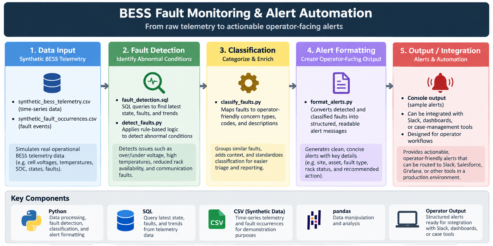

# BESS Fault Monitoring & Alert Automation

A public-safe portfolio project that demonstrates how operational battery energy storage system (BESS) telemetry can be transformed into actionable health and fault alerts.

> **Note:** This project uses fully synthetic data and generic site/asset names. It does not contain proprietary customer data, production schemas, internal URLs, or company-specific code.

## Why I Built This

In utility-scale energy storage operations, operators may need to review multiple systems to understand whether an ESS is faulted, unavailable, in maintenance mode, or operating with reduced rack availability.

This project demonstrates a simplified monitoring workflow that turns raw telemetry into structured operator-facing alerts.

## What the Project Does

1. Loads synthetic BESS telemetry.
2. Finds the latest state for each ESS asset.
3. Detects abnormal operating conditions.
4. Classifies health conditions and active faults.
5. Formats the results into concise operator-facing alerts.
6. Provides a foundation for recurrence tracking, deduplication, dashboards, and predictive diagnostics.

## Example Conditions

The demo currently detects:

- Active equipment faults
- Reduced rack availability
- Maintenance mode
- High cell voltage (> 3.60 V)

## Architecture

```text
Synthetic BESS Telemetry
        |
        v
SQL / Python Detection Logic
        |
        v
Condition Classification
        |
        v
Structured Alert Record
        |
        v
Operator Notification / Dashboard
```

## Repository Structure

```text
bess-fault-monitoring/
├── README.md
├── data/
│   └── synthetic_bess_telemetry.csv
├── sql/
│   └── fault_detection.sql
├── src/
│   ├── detect_faults.py
│   ├── classify_faults.py
│   └── format_alerts.py
├── notebooks/
└── docs/
```

A fault can also be classified into operator-friendly categories such as:

- BMS / Cells / Racks
- PCS / Inverter
- Cooling / TMS
- Communications
- Breaker / Grid Interface

## Skills Demonstrated

- SQL
- Python
- Pandas
- Time-series telemetry analysis
- Rule-based fault detection
- Operational data modeling
- Workflow automation concepts
- BESS domain knowledge
- Technical documentation

## Planned Enhancements

- Fault occurrence IDs and recurrence tracking
- Duplicate alert suppression
- Fault lifecycle states (live / cleared / recurrent)
- Site-level alert grouping
- Historical trend analysis
- Grafana or Streamlit dashboard
- Synthetic anomaly detection for rack voltage behavior
- Slack-style webhook demo

## Portfolio Context

This project is intended to demonstrate how operational domain knowledge can be combined with data analysis and automation to improve technical monitoring and decision support in energy storage environments.

## Sample Output

Example operator-facing alerts generated from the synthetic dataset:

```text
SITE: site_alpha
ASSET: ESS02
TYPE: HEALTH
ALERT: Reduced Rack Availability
RACK STATUS: 21/24
CONCERN: BMS, Cells, Racks, Modules

SITE: site_beta
ASSET: ESS02
TYPE: HEALTH
ALERT: Maintenance Mode
RACK STATUS: 24/24
CONCERN: BMS, Cells, Racks, Modules

SITE: site_gamma
ASSET: ESS01
TYPE: HEALTH
ALERT: Cell Voltage > 3.6V
CONCERN: BMS, Cells, Racks, Modules
